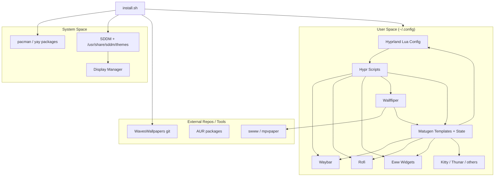
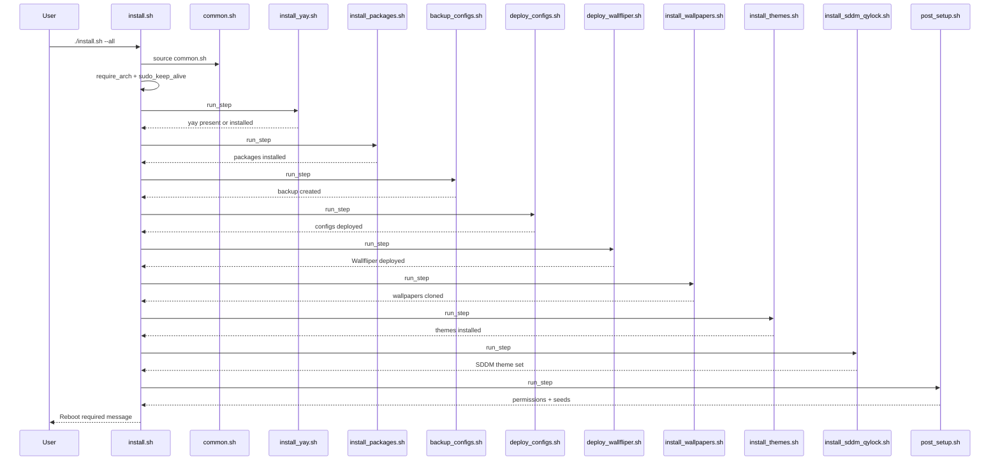
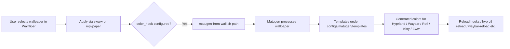
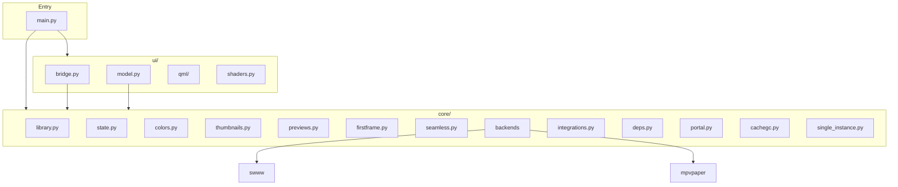

# Architecture — WavesHyprland

## Purpose

This document describes the architecture of WavesHyprland as implemented in the inspected repository (commit `current main`). It covers component relationships, data flows, installation sequence, configuration loading, theming pipeline, and major application interactions.

All descriptions are grounded in static inspection of the source. Runtime behavior is inferred where necessary and marked accordingly.

---

## High-Level Component Map



---

## Installation Architecture

### Entry Point

`install.sh` is the sole documented entry point for end-user installation.

- Sources `scripts/common.sh`
- Provides interactive menu and flag-based non-interactive modes
- Uses `sudo_keep_alive` to refresh the sudo ticket in the background
- Runs ordered steps via `run_step`

### Full Install Sequence



### Key Shared Variables (`common.sh`)

| Variable | Typical Value | Purpose |
|----------|---------------|---------|
| `ROOT` | Repository root | Source of configs/apps/themes |
| `USER_HOME` | Home of invoking (or SUDO_USER) user | Target for user files |
| `CONFIG_DIR` | `$USER_HOME/.config` | Primary deployment root |
| `BACKUP_ROOT` | `$CONFIG_DIR/WavesHyprland-backup-TIMESTAMP` | Backup destination |
| `WAVES_QUIET` | `1` (default) | Suppress non-error logs |

---

## Hyprland Configuration Loading Architecture

### Loading Model

Hyprland is configured via Lua. The entry file is:

`~/.config/hypr/hyprland.lua` (deployed from `configs/hypr/hyprland.lua`)

This file is expected to load the modular configuration files under `~/.config/hypr/configs/`.

Observed modules:

| Module | Path (repo) | Role |
|--------|-------------|------|
| programs | `configs/hypr/configs/programs.lua` | Default applications |
| environment | `configs/hypr/configs/environment.lua` | Env vars (cursor, Qt) |
| colors | `configs/hypr/configs/colors.lua` | Loads matugen-colors or fallback |
| general | `configs/hypr/configs/general.lua` | Gaps, borders, layout |
| decorations | `configs/hypr/configs/decorations.lua` | Rounding, blur, shadows |
| animations | `configs/hypr/configs/animations.lua` | Animation definitions |
| input | `configs/hypr/configs/input.lua` | Keyboard/mouse/touchpad |
| keybinds | `configs/hypr/configs/keybinds.lua` | Keybinding table |
| windowrules | `configs/hypr/configs/windowrules.lua` | Window rules |
| monitors | `configs/hypr/configs/monitors.lua` | Monitor definitions |
| autostart | `configs/hypr/configs/autostart.lua` | Startup commands |
| plugins | `configs/hypr/configs/plugins.lua` | Plugin loading |

### Color Loading Pattern

`colors.lua` attempts to `dofile` `$HOME/.config/hypr/matugen-colors.lua`. If that fails or does not return a table with a `primary` field, a hardcoded Catppuccin-like fallback palette is used. A helper `rgba(hex, alpha)` is provided for border colors.

### Autostart

On `hyprland.start` the following are executed (from inspected `autostart.lua`):

- Waybar reload
- Eww watchdog
- swww-daemon
- Dual (duplicated) `wl-paste` watchers for text and image into cliphist
- polkit agent
- Delayed Wallfliper `--restore` (sleep 5)
- User-editable block delimited by `WAVESOS-USER-AUTOSTART-BEGIN/END` (managed by autostart-editor.sh)

**Known issue:** text and image cliphist watchers are registered twice.

---

## Wallpaper → Theme Pipeline



### Wallfliper Color Hook

Inspected `apps/wallfliper/config.json`:

```json
{
  "color_hook": "/home/bowser/.config/hypr/scripts/matugen-from-wall.sh {path}"
}
```

**Critical finding:** The path is hardcoded to `/home/bowser/...`. Deployment via `rsync` does not rewrite this file. On other users’ systems the hook will fail unless the path is corrected manually or by a post-deploy step that does not currently exist in the inspected scripts.

---

## Wallfliper Application Architecture



- **Entry:** `main.py` (CLI: launch GUI, `--check`, `--restore`, autostart desktop file helpers)
- **UI:** PySide6 + QML, layer-shell integration
- **Backends:** Image (swww/awww), video (mpvpaper)
- **Processing:** Thumbnails, animated previews, first-frame extraction for video, color classification
- **State & cache:** XDG-oriented cache with garbage collection
- **Single instance:** Enforced via `single_instance.py`

System dependencies (not pip-installed by the project installer): PySide6 (system preferred), layer-shell-qt, swww or awww, mpvpaper, ffmpeg.

---

## Eww Widget Architecture

- Declarations in `configs/eww/eww.yuck`
- Styling in `eww.scss` + `colors.scss` (Matugen-generated colors expected)
- Windows: Antares, Fuyue, Rock (and related)
- Scripts under `configs/eww/scripts/` provide CPU, memory, home usage, weather data, time words, SVG generation
- Lifecycle managed in part by `eww-watchdog.sh` and `eww-widget.sh`

Weather data is produced by scripts such as `weather-fetch.sh`, `fuyue-weather.sh`, etc. Exact JSON filenames and API key configuration should be verified at runtime; static inspection shows multiple weather-related scripts that may write different files.

---

## SDDM / qylock Architecture

- Source: `apps/qylock/`
- Deployed to `~/.config/qylock/` (user) and selected theme copied to `/usr/share/sddm/themes/orbital` by default
- Configuration written to `/etc/sddm.conf.d/10-waveshyprland.conf` with `Current=orbital`
- Theme switcher: `~/.config/qylock/sddm.sh` (keybind Super+Shift+I referenced in installer messaging)
- Many QML themes are present (Genshin, Minecraft, Nier Automata, pixel variants, Clockwork, etc.)
- Some paths (quickshell-lockscreen, qt5 themes) are explicitly excluded during rsync in the installer

System-level SDDM files are **not** covered by the normal user config backup mechanism.

---

## Script and Application Interaction Map

Keybindings in `keybinds.lua` invoke scripts under `~/.config/hypr/scripts/`. Representative mappings (not exhaustive):

| Binding pattern | Typical target |
|-----------------|----------------|
| Super + Return / apps | Terminal / app launcher scripts |
| Super + Z / Shift+Z / Alt+Z | `zoom.sh` |
| Ctrl+Esc / Ctrl+Alt+Esc | `waybar-reload.sh` |
| Media keys | `wpctl` / `brightnessctl` directly or via volumecontrol |
| Various Super combinations | `menu.sh`, `rofi_*`, `screenshot.sh`, `power.sh`, `theme-switch.sh`, `cliphist.sh`, etc. |

Editors (settings, keybind, autostart, plugins) are themselves scripts that modify configuration files and may reload Hyprland.

---

## Privilege and Trust Boundaries

| Operation | Privilege | Notes |
|-----------|-----------|-------|
| Package install | root (sudo) | pacman / yay |
| SDDM theme install | root | Writes under `/usr/share/sddm` and `/etc/sddm.conf.d` |
| User config deploy | user | `~/.config` |
| Wallpaper clone | user | `~/Pictures/Wallpapers` |
| Theme install (GTK etc.) | mixed | May require user and system paths |
| Runtime scripts | user | Most Hypr scripts run as the session user |

There is no comprehensive uninstall that reverses system-level SDDM changes. Backup covers user configuration directories only.

---

## Data and State Locations (Typical)

| Path | Purpose |
|------|---------|
| `~/.config/hypr/` | Hyprland config, scripts, colors, lockscreens |
| `~/.config/waybar/` | Waybar layouts and styles |
| `~/.config/rofi/` | Rofi themes and menus |
| `~/.config/eww/` | Eww widgets and scripts |
| `~/.config/wallfliper/` | Wallfliper application |
| `~/.config/matugen/` | Matugen configuration and templates |
| `~/.config/qylock/` | qylock helper and theme sources |
| `~/Pictures/Wallpapers/` | Wallpaper collection |
| `/usr/share/sddm/themes/orbital` | Active SDDM theme (default) |
| `/etc/sddm.conf.d/10-waveshyprland.conf` | SDDM theme selection |
| `~/.config/WavesHyprland-backup-*` | Timestamped backups |

---

## Architecture Diagrams Index

Additional Mermaid diagrams are collected in [appendices/architecture-diagrams.md](appendices/architecture-diagrams.md):

1. Complete project architecture (this document)
2. Installation sequence (this document)
3. Hyprland configuration loading
4. Wallpaper-to-Matugen pipeline (this document)
5. Wallfliper application architecture (this document)
6. Eww widget lifecycle
7. SDDM and lockscreen architecture
8. Major script and application interactions

---

## Limitations of This Architecture Description

- Hyprland’s exact Lua loading order depends on the contents of `hyprland.lua` and any `dofile` / `require` patterns; the inspected entry file is short and relies on the module files.
- Some scripts reference paths or tools that may not be present if optional packages were skipped.
- Wallfliper’s internal worker and transition state machines are described at a high level; deeper class-level documentation is in the `wallfliper/` section.
- Network and AUR availability affect installation success; the architecture assumes a working Arch + network environment.

For implementation-level detail see the subsystem documentation directories and the audit reports.

## Detailed Installer Stage Contracts

### install_yay.sh
- No-op if `command -v yay` succeeds
- Otherwise installs git + base-devel, clones aur.archlinux.org/yay.git, builds with makepkg

### install_packages.sh
- Reads packages/pacman.txt and packages/aur.txt
- Installs via pacman and yay with noninteractive flags as implemented in the script

### backup_configs.sh
- TARGETS array of config directory names
- cp -a each existing target into BACKUP_ROOT
- Also handles mimeapps.list, kdeglobals, ~/.conky

### deploy_configs.sh
- Iterates configs/*/ 
- Skips trees that only contain placeholders
- rsync -a into ~/.config/<name>/

### deploy_wallfliper.sh
- rsync apps/wallfliper to ~/.config/wallfliper
- Does not modify config.json paths
- Does not pip install

### install_wallpapers.sh
- git clone --depth 1 or git pull --ff-only of WavesWallpapers into ~/Pictures/Wallpapers

### install_sddm_qylock.sh
- rsync qylock to ~/.config/qylock with excludes
- Copies Clockwork orbital theme to /usr/share/sddm/themes/orbital
- Writes /etc/sddm.conf.d/10-waveshyprland.conf

### post_setup.sh
- chmod +x on hypr scripts and qylock sddm.sh
- Seeds matugen-colors.lua and kitty colors-matugen.conf if missing
- Creates hypr .cache directory

## Hyprland Module Interaction Detail

colors.lua exports a table and rgba helper. general.lua consumes colors for border definitions. keybinds.lua binds keys to either built-in hl.dsp.* actions or shell scripts. autostart.lua runs after compositor start and is independent of keybinds.

## Wallpaper Color Pipeline Detail

1. User selects wallpaper in Wallfliper GUI
2. Backend applies image (swww) or video (mpvpaper)
3. If color_hook is set, Wallfliper substitutes the path and runs the hook command
4. matugen-from-wall.sh invokes Matugen against templates
5. Generated files update Hyprland colors, Waybar CSS, Rofi rasi colors, Kitty conf, Eww SCSS
6. Reload hooks (hyprctl reload, waybar-reload, etc.) pick up changes

## Known Architectural Debt

1. Hardcoded home in Wallfliper config
2. Duplicate autostart watchers
3. System state not in backup
4. Optional features partially wired
5. Oversized scripts increasing maintenance cost

