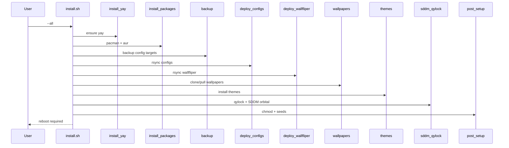

# Installation Flow

**Repository:** WavesHyprland  
**Branch:** main (WavesOS current)
**Version:** 0.1.0

---

## Sequence Diagram

## State After Successful Full Install

- Packages present
- Backup directory created
- ~/.config trees populated
- Wallfliper present (config may need path fix)
- Wallpapers under ~/Pictures/Wallpapers
- Themes installed
- SDDM theme orbital active
- Scripts executable; color seed files present

## Failure Points

| Stage | Common failure |
|-------|----------------|
| yay | network, makepkg deps |
| packages | AUR build failure, conflicts |
| wallpapers | network, git, empty result |
| sddm | sudo failure, missing theme path |
| any | set -e aborts remaining stages |

## Idempotency Notes

- yay: no-op if present
- packages: package manager needed/noconfirm semantics
- backup: always new directory
- deploy: rsync update
- wallpapers: pull or leave or clone
- sddm: re-copy theme and rewrite conf
- post: seed only if missing
